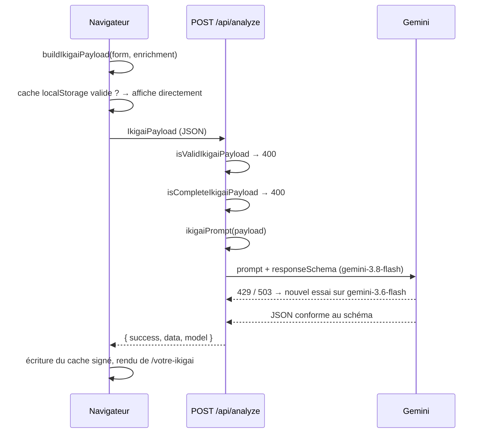
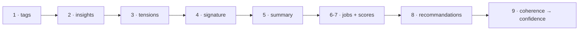

# Ikig-ai 生き甲斐

> Un questionnaire introspectif en 4 piliers, que Gemini transforme en une analyse de carrière personnalisée.

L'utilisateur répond à 12 questions (3 par pilier : ce qu'il **aime**, ce pour quoi il est **doué**, ce dont le monde a **besoin**, ce pour quoi il peut être **payé**). Un seul appel à Gemini en tire un portrait, une lecture croisée, 3 métiers notés et des pistes concrètes.

---

## Sommaire

- [Démarrer](#démarrer)
- [Stack](#stack)
- [Le flux IA en un coup d'œil](#le-flux-ia-en-un-coup-dœil)
- [Ce qui est envoyé](#ce-qui-est-envoyé)
- [Comment l'analyse est construite](#comment-lanalyse-est-construite)
- [Ce qui revient](#ce-qui-revient)
- [Vérifier la sortie](#vérifier-la-sortie)
- [Points techniques importants](#points-techniques-importants)
- [Données personnelles](#données-personnelles)

---

## Démarrer

**Prérequis** : Node 24 (les scripts tournent en TypeScript natif, sans `tsx`), Yarn 1.

```bash
yarn install
cp .env.local.example .env.local 
yarn dev                           # http://localhost:3000
```

`.env.local` :

```bash
GEMINI_API_KEY=...      # clé Google AI Studio
FIXTURES_DEV_KEY=...    # n'importe quelle valeur, protège les routes /dev
```

| Commande                | Rôle                                                                       |
| ----------------------- | -------------------------------------------------------------------------- |
| `yarn dev`              | serveur de dev (Turbopack)                                                 |
| `yarn build` / `start`  | build et serveur de production                                             |
| `yarn lint`             | ESLint (config flat de `eslint-config-next`)                               |
| `yarn fixtures`         | envoie les personas de test à `/api/analyze` (nécessite `yarn dev`)        |
| `yarn seed <persona>`   | ouvre `/votre-ikigai` avec une analyse déjà générée, sans appel à Gemini  |

> Il n'y a pas de suite de tests unitaires. Le harnais de fixtures sert de banc d'essai pour la sortie IA, et la CI GitHub lance le lint et le typecheck.

---

## Stack

| Couche     | Choix                                                     |
| ---------- | --------------------------------------------------------- |
| Framework  | Next.js 16 (App Router), React 19, TypeScript strict      |
| Style      | Tailwind CSS 4, tokens dans `app/globals.css`             |
| Animation  | `motion` (Framer Motion), View Transitions API            |
| IA         | `@google/genai` : Gemini 3.8 Flash, avec repli sur 3.6 Flash |
| Icônes     | `@phosphor-icons/react`                                   |
| Stockage   | `localStorage` uniquement : aucune base, aucun compte     |

---

## Le flux IA en un coup d'œil



| Fichier                                | Rôle                                                       |
| -------------------------------------- | ---------------------------------------------------------- |
| `app/hooks/useIkigaiAnalyze.ts`        | appel client, cache, messages d'erreur en français         |
| `app/api/analyze/route.ts`             | validation, appel Gemini, chaîne de repli, codes HTTP      |
| `app/api/analyze/utils.ts`             | gardes du payload, signature du cache, `buildIkigaiPayload` |
| `app/utils/ikigaiPrompt.ts`            | prompt système (rôle, lecture, méthode en 9 étapes, ton)   |
| `app/utils/ikigaiPromptData.ts`        | bloc de données utilisateur (questions ↔ réponses)        |
| `app/api/analyze/responseSchema.ts`    | schéma imposé à Gemini, miroir de `types/response.ts`      |
| `lib/gemini.ts` / `lib/geminiModel.ts` | client SDK (serveur) / noms des modèles (importable côté client) |

---

## Ce qui est envoyé

### Le payload (`IkigaiPayload`)

Un tableau de 3 réponses par pilier, **dans l'ordre des questions**. Une question sautée reste `""` à son index. `enrichment` n'est présent que si au moins un champ du profil facultatif est rempli.

```jsonc
{
  "love":   ["réponse Q1", "réponse Q2", ""],   // "" = question sautée
  "talent": ["…", "…", "…"],
  "needs":  ["…", "", "…"],
  "paid":   ["…", "…", "…"],
  "enrichment": {               // facultatif, chaque champ aussi
    "mbti": "INFP",
    "disc": "blue",
    "currentJob": "Responsable d'atelier",
    "satisfaction": 3,          // 0 à 10
    "age": 34
  }
}
```

**Règle de complétude**, appliquée par l'UI _et_ par la route : une réponse ne compte qu'à partir de **60 caractères**, et chaque pilier en exige **2 sur 3**. Sans ce garde-fou côté serveur, le schéma forcerait Gemini à inventer un profil à partir de rien.

### Ce que Gemini lit vraiment

Le payload n'est jamais envoyé brut. `buildUserDataBlock()` le met en forme pour le modèle :

```text
[LOVE] Ce que vous aimez
Q1. <question posée>
R1. <réponse>

Q2. <question posée>
R2. (non renseignée)
---
[PROFIL COMPLÉMENTAIRE]
type MBTI : INFP · Médiateur
profil comportemental DISC : Consciencieux
satisfaction dans le poste actuel : 3/10
---
[MATIÈRE REÇUE]
questions laissées vides : 1 sur 12 (LOVE Q2)
```

- **Chaque réponse est appariée à sa question** : la même phrase n'a pas le même sens selon ce qu'on a demandé.
- **Les codes sont traduits en clair** (`blue` → libellé DISC, `INFP` → `INFP · Médiateur`).
- **Le nombre de questions vides est calculé** et non laissé au modèle, qui compte mal.
- Les réponses sont déclarées comme **données, jamais instructions** (protection contre l'injection de prompt).

---

## Comment l'analyse est construite

Le prompt suit une **méthode en 9 étapes**, et `propertyOrdering` dans le schéma force Gemini à générer le JSON **dans ce même ordre**. Comme un LLM écrit token par token, chaque champ s'appuie sur ceux qui le précèdent :



- **Les tags d'abord** : ils servent d'index pour justifier les métiers.
- **La signature avant le portrait** : le portrait la développe au lieu de la répéter.
- **Dans chaque insight, `pillars` avant `text`** : le modèle choisit le croisement, puis l'écrit.
- **La confiance en dernier** : constats → niveau → pourcentage. Le chiffre découle des constats, il ne les résume pas.

### Le profil facultatif : 3 usages, du plus fort au plus faible

1. **La formulation** : plus analytique ou plus relationnelle.
2. **L'arbitrage** entre deux métiers d'égale pertinence.
3. **L'écart** : une contradiction nette avec les réponses peut être soulevée, comme une hypothèse à vérifier.

Les 4 piliers gardent toujours le dernier mot. `satisfaction` est le champ le plus déterminant, parce que c'est lui qui fixe le registre (voir ci-dessous).

### Pour qui la sortie est calibrée

| Persona                                 | Ce qu'il attend                                                                                 |
| --------------------------------------- | ----------------------------------------------------------------------------------------------- |
| **En orientation, sans expérience**     | son pilier « payé » est mince parce que personne ne l'a encore payé, pas parce qu'il a mal répondu |
| **En poste et insatisfait** (cœur de cible) | savoir si c'est le métier ou le cadre qui ne va pas, sans qu'on lui reformule ses propres réponses |
| **Curieux, sans urgence**               | des directions à approfondir, pas une reconversion                                              |

### Les règles à ne pas affaiblir

| Règle                                                                    | Pourquoi                                                                                       |
| ------------------------------------------------------------------------ | ---------------------------------------------------------------------------------------------- |
| `satisfaction` fixe le registre (0–4 franc, 7–10 approfondissement, vide = intermédiaire) | à 2/10, la prudence passe pour de la langue de bois ; à 8/10, personne n'a demandé de rupture |
| `confidence` mesure la cohérence de ce qui a été dit, jamais la maturité professionnelle | sinon un lycéen lit une mauvaise note là où il n'y a qu'un manque d'expérience (plancher à 65 dans ce cas) |
| Les `insights` montrent ce qui **se tient**, les `tensions` ce qui **tire dans deux sens** | sans cette ligne de partage, les deux blocs se ressemblent                                     |
| Les `pillars` d'un insight sont ceux que la phrase relie vraiment        | la tresse 結び les dessine : un nœud décoratif ferait mentir l'illustration                    |
| La `signature` (28 mots max.) est citable telle quelle                   | c'est la phrase que la personne répètera à quelqu'un d'autre                                   |
| Tous les scores sont des **multiples de 5**                              | on estime en lisant du texte, on ne mesure pas : un 73 ferait croire à un calcul                |
| Chaque score se défend par son `match_reason`                            | un chiffre que le texte n'explique pas est décoratif                                           |
| Les 3 métiers couvrent **au moins 2 familles**, en restant les plus proches des réponses | jamais deux intitulés pour un même rôle, et pas de variété pour le principe                |
| Rien ne reproche à l'utilisateur ce qu'il n'a pas écrit                  | il ne fera le test qu'une fois, l'analyse doit se suffire à elle-même                          |

**Le seuil minimal de qualité** : au moins une phrase que la personne n'aurait pas pu écrire elle-même. Si une phrase de la sortie peut être reconstituée à partir d'une seule réponse du formulaire, c'est de la paraphrase.

---

## Ce qui revient

### La réponse de la route

```jsonc
// 200
{ "success": true, "data": IkigaiAnalysisResult, "model": "gemini-3.8-flash" }

// 400 payload invalide ou incomplet · 429 quota · 503 surcharge · 502 JSON vide ou illisible · 500 autre
{ "success": false, "error": "message pour les développeurs" }
```

Les messages d'`error` ne sont jamais montrés à l'utilisateur : le client choisit un texte en français d'après le **code HTTP**.

### Les champs de l'analyse (`IkigaiAnalysisResult`)

Ils sont présentés dans l'**ordre de génération**.

| Champ                             | Contrainte du schéma                         | Tâche demandée au modèle                                                                 | Affichage                          |
| --------------------------------- | -------------------------------------------- | ---------------------------------------------------------------------------------------- | ---------------------------------- |
| `tags.{love,talent,needs,paid}`   | 4–5 par pilier, 1–3 mots, minuscules         | extraire les concepts, y compris implicites, sans recopier                               | nuage de mots                      |
| `analysis.insights[].pillars`     | 2–4 clés de pilier, sans doublon             | choisir les piliers que la phrase relie réellement                                       | nœuds de la tresse 結び            |
| `analysis.insights[].text`        | 3–4 insights                                 | dire ce qui se tient entre les piliers, sans métier ni conseil                           | « lecture croisée »                |
| `analysis.tensions`               | 0–3                                          | ce qui tire dans deux sens, jamais un insight déguisé                                    | point de vigilance                 |
| `signature`                       | 1 phrase, 28 mots max.                       | nommer le moteur de la personne, citable, impossible à appliquer à quelqu'un d'autre     | grande phrase en tête de fiche     |
| `summary.profile`                 | 4–6 phrases                                  | portrait au vouvoiement qui prouve la signature sans la répéter                          | « synthèse »                       |
| `summary.key_strengths`           | 3–4, 2–6 mots                                | compétences transférables que la personne sous-estime                                    | carte « forces »                   |
| `summary.motivations`             | 3–4, 2–6 mots                                | le moteur, pas le goût                                                                   | carte « motivations »              |
| `summary.work_environment`        | 3–4                                          | conditions de travail favorables, assez précises pour ne pas valoir pour tout le monde   | carte « environnement »            |
| `jobs[].title` / `description`    | exactement 3 métiers                         | métier existant sur le marché francophone, quotidien concret                             | fiches « orientations »            |
| `jobs[].match_reason`             | —                                            | pourquoi ça colle : ≥ 2 tags, un écho précis aux réponses, seul champ qui cite           | dos de la fiche métier             |
| `jobs[].ikigai_scores`            | 0–100 par pilier, multiples de 5             | correspondance du métier avec chaque pilier                                              | barres de score                    |
| `jobs[].score`                    | 40–95, multiple de 5                         | pertinence globale, générée **après** le détail par pilier                               | score de la fiche                  |
| `recommendations.actions`         | exactement 3                                 | pistes activables vite, de natures différentes, dont une gratuite                        | « pistes pour avancer »            |
| `recommendations.warning`         | toujours présent                             | un seul repère, proportionné, jamais un reproche                                         | vigilance finale                   |
| `coherence.signals`               | 2–3, pris dans une liste fermée (`enum`)     | constats factuels sur la matière reçue                                                   | échelle de cohérence               |
| `coherence.level`                 | `faible` · `moyenne` · `bonne` · `forte`     | niveau déduit des constats                                                               | échelle de cohérence               |
| `confidence`                      | 40–95, multiple de 5                         | pourcentage borné par le niveau (faible 50–60 … forte 90+)                               | signal de cohérence                |

### Prose ou schéma : qui garantit quoi ?

- **Le schéma** (`responseSchema` + `responseMimeType: "application/json"`) garantit la **structure** : champs obligatoires, nombre d'éléments, bornes, valeurs autorisées, ordre de génération.
- **Le prompt** porte ce qu'un schéma ne peut pas exprimer : le ton, la non-paraphrase, l'interdiction de citer hors `match_reason`, les multiples de 5.

> ⚠️ `responseSchema.ts` et `types/response.ts` décrivent la même forme : **modifie toujours les deux ensemble**. Si tu ajoutes un champ, incrémente aussi `ANALYSIS_SCHEMA_VERSION` (`app/api/analyze/utils.ts`) pour invalider les analyses en cache.

---

## Vérifier la sortie

### Les fixtures

Quatre personas partagés (`scripts/fixtures.ts`). Chacun porte un `probe`, c'est-à-dire ce qu'il met à l'épreuve :

| Slug               | Profil                                                         | Ce qu'il teste                                                                                          |
| ------------------ | -------------------------------------------------------------- | ------------------------------------------------------------------------------------------------------- |
| `student`          | lycéenne handballeuse, aucune expérience pro, 9/12, sans profil | pilier « payé » mince sans pénalité : `confidence` ≥ 65                                                 |
| `unhappy-employee` | responsable d'atelier agroalimentaire, 12/12, profil complet, satisfaction 3 | registre franc, refus du management respecté dans les 3 métiers, tension autonomie / besoin de cadre |
| `minimal`          | réponses vagues, 8/12, juste au-dessus du seuil               | bas de l'échelle de confiance (≈ 55–65), pas de profil inventé                                          |
| `curious-explorer` | professeure des écoles, 10/12, profil partiel, satisfaction 8  | registre d'approfondissement, pas de reconversion                                                       |

Les réponses de vraies personnes vont dans `scripts/fixtures.local.json` (gitignoré, même format), jamais dans le dépôt.

```bash
yarn fixtures                  # 1 appel par persona → scripts/output/<date>/<slug>.json
yarn fixtures --only=student   # un seul persona
yarn fixtures --runs=2         # 2 passes : mesure la variance pour un même persona
yarn fixtures --report-only    # recalcule les mesures sans appeler l'API
yarn seed student              # affiche le résultat dans la vraie page
```

### Les contrôles automatiques

| Type de contrôle | Ce qu'il signale                                                                                         | Gravité                            |
| ---------------- | -------------------------------------------------------------------------------------------------------- | ---------------------------------- |
| `contrat`        | cardinalités du schéma, intitulés de métier en double, insight relié à moins de 2 piliers, champ manquant | **bug** : schéma, types et UI ne concordent plus |
| `regle`          | score hors des multiples de 5, piliers à plat, nom de pilier dans la prose, ouverture interdite, tiret cadratin, guillemets hors `match_reason` | le prompt n'est pas respecté |
| `vigilance`      | reprise mot pour mot de 6 mots des réponses, éléments de synthèse trop longs                             | à relire                           |

Des **mesures d'uniformité** viennent s'y ajouter : débuts des portraits, écart de confiance entre personas, chevauchement lexical, métiers proposés à plusieurs personas. Elles repèrent un prompt qui produirait la même analyse pour tout le monde.

> **Quota du free tier** : 20 requêtes par jour et par modèle, soit 40 avec le repli. Comptez 4 à 5 runs complets par jour. Sur une erreur 5xx, le harnais réessaie jusqu'à 3 fois ; sur une 429, il s'arrête aussitôt.

---

## Points techniques importants

- **Chaîne de repli des modèles** (`GEMINI_MODELS`) : uniquement sur 429 ou 503, parce que chaque modèle a son propre quota. Toute autre erreur s'arrête tout de suite, puisque le modèle suivant échouerait de la même façon. Le modèle qui a réellement répondu est renvoyé, mis en cache et affiché.
- **Réglages Gemini 3** : pas de `temperature` (Google recommande de garder la valeur par défaut, 1.0) et `thinkingLevel: MEDIUM`. Au niveau `high`, par défaut, une analyse prenait environ 4 min 40.
- **Clé API lue à la demande** : `getGemini()` lève l'erreur _dans_ la route, qui renvoie donc toujours du JSON, jamais une page d'erreur HTML.
- **Frontière client / serveur** : `lib/geminiModel.ts` est séparé du SDK, et la validation est importée avec `import type`. La route ne tire ainsi aucun module client, et le client n'embarque pas le SDK.
- **Cache d'analyse** (`localStorage`, `ikigai-analysis-cache`) : la clé est une signature du payload normalisé, préfixée par `ANALYSIS_SCHEMA_VERSION`. Elle change dès qu'une réponse ou un champ du profil change. Le cache conserve aussi `analyzedAt` et `model`. **Chaque appel à `buildIkigaiPayload` doit recevoir `enrichment`**, sinon les signatures divergent.
- **Hydratation** : toute redirection qui dépend des réponses doit attendre `isHydrated`, sinon elle se déclenche sur l'état vide avant la lecture de `localStorage`.
- **Nettoyage au rendu** : `withoutStrayQuotes()` retire les guillemets que le modèle laisse hors de `match_reason`.
- **Routes `/dev`** : en 404 en production, et protégées par `FIXTURES_DEV_KEY` (comparaison en `timingSafeEqual`).
- **Grounding Google Search** : indisponible sur le free tier de Gemini 3.x. L'analyse n'a donc pas de vue en temps réel sur le marché de l'emploi.

Pour l'architecture de l'interface (formulaire, sceau, tresse 結び, impression PDF), voir [`CLAUDE.md`](CLAUDE.md).

---

## Données personnelles

Rien n'est stocké sur un serveur : les réponses, le profil et l'analyse restent dans le `localStorage` du navigateur, et « réinitialiser » efface tout. En revanche, les réponses sont **envoyées à l'API Gemini de Google (offre gratuite)**. Selon les conditions de Google, ces contenus peuvent servir à améliorer leurs produits et être relus par des personnes. **Ne saisissez pas d'informations sensibles.**
